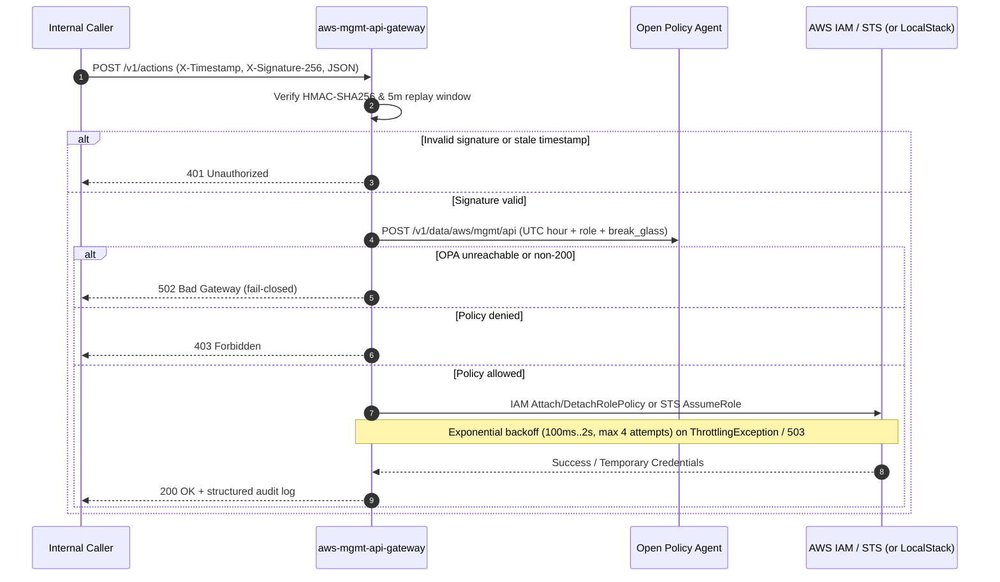

# Design Document: Internal API Layer over AWS Management APIs (`aws-mgmt-api-gateway`)

## 1. Problem Statement
Granting internal automation platforms, CI/CD runners, and on-call engineers direct access to AWS IAM and STS APIs creates three operational issues:
1. **Unbounded blast radius:** Callers with direct `iam:AttachRolePolicy` or `sts:AssumeRole` permissions can mutate roles outside approved operating windows or without incident tracking.
2. **Inconsistent retry and timeout handling:** Internal callers fail abruptly when AWS STS or IAM returns `ThrottlingException` or HTTP `503`.
3. **Session expiry during active incidents:** Short-lived temporary credentials expire mid-remediation unless an explicit, auditable grace-period extension exists.

`aws-mgmt-api-gateway` places a single authenticated HTTP service (`POST /v1/actions`) in front of AWS IAM and STS, enforcing HMAC-SHA256 request signing, Open Policy Agent (OPA) policy checks, and exponential backoff retries.

---

## 2. Request Flow & Failure Handling

---

## 3. Edge Cases & Failure Modes

| Failure Mode | System Behavior |
| :--- | :--- |
| **Upstream `ThrottlingException` or HTTP `503`** | `internal/cloud_client` retries up to 4 attempts with exponential backoff (`100ms`, `200ms`, `400ms`, capped at `2s`), honoring context cancellation. |
| **Malformed or replayed webhook signatures** | `internal/auth` rejects missing headers, timestamps skewed more than `±300s` from UTC now, or mismatched HMAC-SHA256 digests with `401 Unauthorized` before touching OPA or AWS. |
| **Daylight Saving Time (DST) transitions** | Operating hours (`05:00–22:00 UTC`) are evaluated strictly in UTC (`time.Now().UTC().Hour()`), eliminating spring-forward/fall-back policy drift. |
| **Credential expiry during an active incident** | When `break_glass.enabled` is true with a valid incident ID (`>= 6` chars) and justification (`>= 10` chars), `AssumeRole` automatically appends a 900-second (`15m`) grace extension (`grace_extended: true`). |
| **OPA container outage** | The gateway fails closed and returns `502 Bad Gateway` rather than executing unapproved AWS API calls. |

---

## 4. Trade-Offs & Known Limitations
- **Synchronous execution model:** Requests block while OPA evaluates and AWS responds. Long-running multi-account fan-out workflows should enqueue jobs ahead of this gateway.
- **Static HMAC shared secret:** For local and internal service-to-service callers, requests are authenticated via `X-Signature-256` + `X-Timestamp`. In multi-tenant deployments, replace the single shared secret with per-caller key IDs (`X-Key-ID`) or mTLS client certificates.
- **Single-region client initialization:** The gateway initializes a single AWS SDK client per process (`AWS_REGION`). Multi-region targets require either per-request region routing or separate regional gateway instances.
